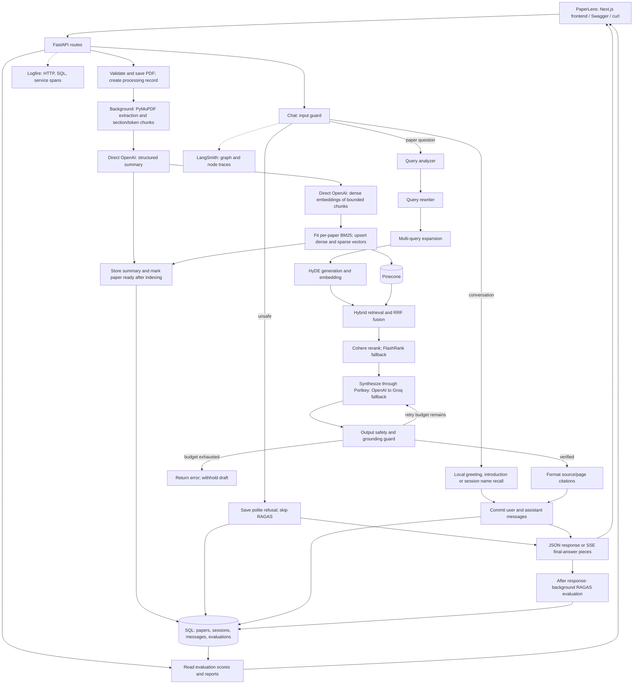

# PaperLens — Research Assistant for PDFs

PaperLens is a research workspace that turns uploaded PDFs into structured
summaries and paper-grounded conversations with page citations. A Next.js
frontend connects to a FastAPI backend, with a ten-node LangGraph workflow for
retrieval, reranking, generation and safety checks.

The project includes a working paper library, streamed chat, evidence panels,
persistent SQL conversation history and background RAGAS quality reports. This
README is the setup and demonstration guide for the submitted implementation.
Detailed implementation notes are in [backend/README.md](backend/README.md) and
[frontend/README.md](frontend/README.md).

## Contents

- [Features](#features)
- [Technology stack](#technology-stack)
- [Prerequisites](#prerequisites)
- [Setup](#setup)
- [Demonstration workflow](#demonstration-workflow)
- [Configuration](#configuration)
- [Architecture](#architecture)
- [API reference](#api-reference)
- [Curl walkthrough](#curl-walkthrough)
- [Streaming and evaluation](#streaming-and-evaluation)
- [LangGraph Studio](#langgraph-studio)
- [Retrying a failed upload](#retrying-a-failed-upload)
- [Checks and troubleshooting](#checks-and-troubleshooting)
- [Current limitations](#current-limitations)
- [Project layout](#project-layout)
- [Submission notes](#submission-notes)

## Features

- **Paper library:** upload text-based PDFs, search/filter/sort the collection,
  follow processing status, and delete papers with their associated data.
- **Structured summaries:** title/authors, abstract, problem statement,
  methodology, key results and conclusion.
- **Agentic retrieval:** query classification and rewriting, three alternative
  queries, HyDE, dense/BM25 hybrid search, reciprocal rank fusion and reranking.
- **Grounded chat:** reusable paper-scoped sessions, full saved message history,
  page citations and inspectable source excerpts. Short conversational replies
  and session-scoped name recall are handled locally.
- **Streaming:** workflow updates followed by validated answer text, with
  interruption recovery and explicit retry controls. Switching paper tabs keeps
  the active chat request and unsent draft alive.
- **Safety and provider routing:** NeMo input/output checks, deterministic
  jailbreak patterns, bounded answer retries and Portkey OpenAI-to-Groq fallback.
- **Quality evaluation:** background faithfulness, answer relevancy and context
  utilization scores; per-answer, session and paper reports.
- **Interface and observability:** responsive layouts, light/dark themes,
  accessible dialogs, optional Logfire/LangSmith tracing and a Studio entry point.

## Technology stack

| Layer          | Implementation                                                                                  |
| -------------- | ----------------------------------------------------------------------------------------------- |
| Frontend       | Next.js App Router, React, strict TypeScript, Tailwind CSS, Radix UI primitives, TanStack Query |
| API            | FastAPI, Pydantic settings, Uvicorn                                                             |
| Agent workflow | LangGraph, LangChain, NeMo Guardrails                                                           |
| PDF processing | PyMuPDF, Unicode normalization, tiktoken, bounded section/page chunking                         |
| Retrieval      | Pinecone dense/sparse vectors, per-paper BM25, RRF                                              |
| Reranking      | Cohere with local FlashRank fallback                                                            |
| Generation     | OpenAI directly for summaries; Portkey gateway for agent calls                                  |
| Storage        | Async SQLAlchemy; SQLite for local development                                                  |
| Evaluation     | RAGAS, Hugging Face Datasets, direct OpenAI evaluation models                                   |
| Observability  | Logfire spans, LangSmith traces, LangGraph Studio                                               |
| Verification   | Python unittest, Vitest, Playwright desktop/mobile tests                                        |

Backend versions are pinned in [requirements.txt](backend/requirements.txt).
Frontend versions are recorded in [package.json](frontend/package.json) and
[package-lock.json](frontend/package-lock.json); use `npm ci` for installation.

## Prerequisites

| Requirement                                        | Purpose                                               |
| -------------------------------------------------- | ----------------------------------------------------- |
| Python **3.11**                                    | Backend and the pinned LangGraph development runtime  |
| Node.js **22.13+** and npm                         | Frontend and its lint/test tooling                    |
| Git, or an extracted submission archive            | Project source                                        |
| Internet access                                    | Package/model downloads and hosted AI/vector services |
| OpenAI API key                                     | Direct summaries, embeddings and evaluation           |
| Pinecone account/API key                           | Vector index initialization, indexing and retrieval   |
| Portkey account/API key and provider configuration | Agent/guardrail calls and configured model fallback   |

Groq credentials belong in the configured fallback target. Cohere, Logfire and
LangSmith are optional; local FlashRank can replace Cohere. Hosted services need
appropriate model access and available account quota. ChatGPT access does not
configure the OpenAI API credentials used by this project.

## Setup

The primary instructions below use **Windows PowerShell with Conda**. Commands
must run from the stated directory. Use two terminals: one for FastAPI and one
for Next.js. Studio is optional and uses a third terminal.

### 1. Get the source

Skip cloning if you already have the project or extracted the submission archive.
Use the source branch supplied with the submission.

```powershell
git clone https://github.com/Husniahmed10/Research-Assistant-for-PDFs.git
cd Research-Assistant-for-PDFs
```

### 2. Create or activate the backend environment

From the repository root:

```powershell
conda create -n redoc python=3.11 -y
conda activate redoc
cd backend
python --version
python -m pip install -r requirements.txt
```

If `redoc` already exists with Python 3.11, skip `conda create`. The environment
name is arbitrary; use the same interpreter for installation and running the API.

Alternatively, from the repository root use Python's built-in virtual environment:

```powershell
py -3.11 -m venv .venv
.\.venv\Scripts\Activate.ps1
cd backend
python -m pip install -r requirements.txt
```

On macOS/Linux, the equivalent environment setup is:

```bash
python3.11 -m venv .venv
source .venv/bin/activate
cd backend
python -m pip install -r requirements.txt
```

Run subsequent backend Python commands **from `backend/`** with this environment active.
The settings loader reads `.env` relative to the working directory; the default
SQLite database, uploads and model cache paths are also relative to it.

### 3. Configure the backend

```powershell
if (-not (Test-Path .env)) { Copy-Item .env.example .env }
```

On macOS/Linux, use `[ -f .env ] || cp .env.example .env` for the copy step.
Edit `backend/.env` using the [configuration guide](#configuration). Replace the
required placeholders and clear unused optional credentials. In particular, the
template's Cohere, Logfire and LangSmith placeholders are not working tokens.
For a local run without those optional services, the essential configuration is:

```dotenv
OPENAI_API_KEY=<your-openai-api-key>
OPENAI_MODEL=gpt-4o
OPENAI_EMBEDDING_MODEL=text-embedding-3-small
PORTKEY_API_KEY=<your-portkey-api-key>
PORTKEY_CONFIG_ID=<your-saved-openai-groq-fallback-config-id>
PINECONE_API_KEY=<your-pinecone-api-key>
PINECONE_INDEX_NAME=research-assistant
PINECONE_ENVIRONMENT=us-east-1
PINECONE_DIMENSION=1536
DATABASE_URL=sqlite+aiosqlite:///./research_assistant.db
UPLOAD_DIR=uploads
MAX_FILE_SIZE_MB=50
COHERE_API_KEY=
LOGFIRE_TOKEN=
LANGCHAIN_API_KEY=
LANGCHAIN_TRACING_V2=false
DEBUG=false
```

Replace the angle-bracket placeholders with actual credentials. Set up the saved
Portkey config as described [below](#portkey-fallback-setup). It must contain
working provider targets; an OpenAI-only success does not prove the Groq fallback
has been exercised. Keep unused inline virtual-key/Groq placeholders empty when
using a saved config. Retain other template settings at their defaults as needed.

Keep the pinned compatibility sets together: NumPy 1.26/PyArrow 24/Pandas 2.2 for
RAGAS, and the listed Logfire/OpenTelemetry/setuptools versions for tracing. Do not
independently upgrade these packages when reproducing the submission.

For VS Code, run **Python: Select Interpreter** and choose this environment.
Verify that the active interpreter can import the required packages:

```powershell
python -c "import sys, fastapi, pinecone, logfire, ragas, pyarrow, pandas; print(sys.executable); print('Backend imports OK')"
```

### 4. Prepare retrieval resources

```powershell
python -m nltk.downloader punkt punkt_tab stopwords
python -c "from services.reranker import prepare_flashrank; prepare_flashrank()"
```

NLTK resources support BM25 tokenization. The second command downloads/loads the
local FlashRank model. Keep its cache available if you want reranking fallback
without downloading weights at request time.

### 5. Start the backend — terminal 1

```powershell
python -m uvicorn main:app --reload --host 127.0.0.1 --port 8000
```

Open:

- Swagger UI: <http://127.0.0.1:8000/docs>
- ReDoc: <http://127.0.0.1:8000/redoc>
- OpenAPI JSON: <http://127.0.0.1:8000/openapi.json>
- Liveness: <http://127.0.0.1:8000/>

There is no separate table-creation command for local setup. Startup configures
LangSmith before graph imports and Logfire before serving, then initializes DB
tables, connects/creates the Pinecone index, loads saved BM25 parameters, and
creates the uploads directory. Initialization failures stop startup. API routers
are registered once during app construction.

Wait for Uvicorn's application-startup-complete message before uploading. Startup
requires a working Pinecone connection even when you only intend to use Swagger.

### 6. Install and configure the frontend — terminal 2

Open a new terminal **at the repository root**. The frontend uses Node.js; it does
not need a Python environment activated.

```powershell
cd frontend
node --version
npm --version
npm ci
if (-not (Test-Path .env.local)) { Copy-Item .env.example .env.local }
```

Ensure `frontend/.env.local` contains:

```dotenv
NEXT_PUBLIC_API_BASE_URL=http://localhost:8000
NEXT_PUBLIC_MAX_FILE_SIZE_MB=50
```

The size setting must match `MAX_FILE_SIZE_MB` in the backend. These are public
browser settings. Provider keys belong only in `backend/.env`.

```powershell
npm run dev
```

Open **http://localhost:3000**. Use `localhost` for the frontend origin because
the backend CORS configuration allows `http://localhost:3000`. If you change the
frontend host/port, update `backend/main.py` accordingly. Restart Next.js after
changing frontend environment variables; production values are embedded at build time.

If using Windows CMD/Anaconda Prompt instead of PowerShell, the file-copy equivalents are:

```bat
rem From backend:
if not exist .env copy .env.example .env
rem From frontend:
if not exist .env.local copy .env.example .env.local
```

On macOS/Linux, use `[ -f .env.local ] || cp .env.example .env.local` for the
frontend configuration copy. Other npm commands are the same.

### 7. Verify both applications

| URL                          | Expected result                                 |
| ---------------------------- | ----------------------------------------------- |
| `http://localhost:8000/`     | JSON containing `status: "ok"` and the app name |
| `http://localhost:8000/docs` | Interactive API documentation                   |
| `http://localhost:3000`      | PaperLens library and API connection indicator  |

The root API endpoint is a lightweight check. `/api/v1/health/` additionally calls
DB, Pinecone and the model gateway; use it on demand rather than frequent polling.

### Optional: run the optimized frontend build

Stop the Next.js development server before running another frontend server on
the same port. From `frontend/`:

```powershell
npm run build
npm start
```

For a local backend run without development reload, omit `--reload` from the
Uvicorn command. These commands run the applications; deployment access control,
HTTPS and durable workers require additional infrastructure.

## Demonstration workflow

1. Start the backend and frontend using the instructions above.
2. Upload a text-based research PDF from **Paper library**. The default upload
   limit is 50 MB. Upload acceptance and background preparation are separate.
3. Wait for **Ready**. Large sections are split before embedding/indexing; the
   UI shows processing status without inventing a completion percentage.
4. Open the paper's **Summary** and review its six structured sections.
5. Choose **Chat with paper**, create a conversation and ask, for example,
   **"What are the main contributions?"** or **"What are the limitations?"**
6. Follow workflow updates, then click a source label/page chip to inspect the
   exact excerpt used for the answer.
7. Ask a follow-up in the same conversation. Reload the page to confirm saved
   history; conversation-discovery links are stored in that browser.
8. After evaluation finishes, expand the answer's evaluation or open **Answer
   quality**. Missing/skipped/failed scores are shown explicitly.
9. Optionally demonstrate a harmless name introduction and recall in the same
   session, or the guardrail response to an instruction-override request.

For a submission recording, a useful sequence is upload → Ready → summary →
question → evidence → follow-up → quality report. Use a PDF you are permitted
to share and keep credentials out of the recording.

## Configuration

Start from [backend/.env.example](backend/.env.example). Never commit `.env`,
provider credentials, uploaded PDFs, local databases or downloaded model weights.

| Setting                                                  | Purpose / local default                                                                                                            |
| -------------------------------------------------------- | ---------------------------------------------------------------------------------------------------------------------------------- |
| `OPENAI_API_KEY`                                         | Required for direct summary generation, embeddings and RAGAS. A Portkey virtual key does not replace this direct API key.          |
| `OPENAI_MODEL`                                           | Summary model and requested primary chat model; default `gpt-4o`.                                                                  |
| `OPENAI_EMBEDDING_MODEL`                                 | Default `text-embedding-3-small`; embedding dimensions must match the Pinecone index.                                              |
| `PORTKEY_API_KEY`                                        | Required for gateway calls used by the chat agent and semantic guardrails.                                                         |
| `PORTKEY_CONFIG_ID`                                      | Saved gateway configuration defining primary OpenAI and secondary Groq targets. Preferred when inline configs are blocked.         |
| `PORTKEY_VIRTUAL_KEY_OPENAI`, `PORTKEY_VIRTUAL_KEY_GROQ` | Portkey virtual key IDs used when building an inline fallback config.                                                              |
| `GROQ_API_KEY`, `GROQ_MODEL`                             | Inline fallback credentials/model if virtual keys or Model Catalog names are not used. A saved config manages its own targets.     |
| `PINECONE_API_KEY`, `PINECONE_INDEX_NAME`                | Required vector service access and the index name; default name `research-assistant`.                                              |
| `PINECONE_ENVIRONMENT`, `PINECONE_DIMENSION`             | AWS region (default `us-east-1`) and dense dimension (default `1536`). Index metric must be `dotproduct`.                          |
| `DATABASE_URL`                                           | Async database URL; default `sqlite+aiosqlite:///./research_assistant.db`.                                                         |
| `UPLOAD_DIR`, `MAX_FILE_SIZE_MB`                         | Upload directory and maximum file size; defaults `uploads`, `50`.                                                                  |
| `CHUNK_SIZE`, `CHUNK_OVERLAP`                            | Token windows; defaults `512`, `64`. Short semantic sections stay whole; longer sections are split into page windows with overlap. |
| `TOP_K_RETRIEVAL`, `TOP_K_RERANK`, `HYBRID_ALPHA`        | Defaults `20`, `5`, `0.7`. Alpha weights dense vs sparse query vectors.                                                            |
| `COHERE_API_KEY`, `COHERE_RERANK_MODEL`                  | Optional primary reranker; clear the key to use local FlashRank. Default model `rerank-english-v3.0`.                              |
| `FLASHRANK_MODEL`, `FLASHRANK_CACHE_DIR`                 | Local reranker and cache; defaults `ms-marco-TinyBERT-L-2-v2`, `.cache/flashrank`.                                                 |
| `LOGFIRE_TOKEN`                                          | Optional; leave empty for local-only tracing without cloud export.                                                                 |
| `LANGCHAIN_API_KEY`, `LANGCHAIN_TRACING_V2`              | Optional LangSmith tracing; empty key or `false` disables remote tracing.                                                          |
| `LANGCHAIN_PROJECT`, `LANGCHAIN_ENDPOINT`                | LangSmith project and endpoint; defaults `research-assistant`, `https://api.smith.langchain.com`.                                  |
| `DEBUG`                                                  | Controls SQLAlchemy query echo; use `false` to avoid verbose SQL logs.                                                             |

Clear these optional example values if you are not using their services:

```dotenv
COHERE_API_KEY=
LOGFIRE_TOKEN=
LANGCHAIN_API_KEY=
LANGCHAIN_TRACING_V2=false
```

### Portkey fallback setup

In Portkey, configure working OpenAI and Groq provider credentials and create a
saved fallback config. Use actual virtual key IDs and models enabled in your
accounts in place of the placeholders below:

```json
{
  "strategy": { "mode": "fallback" },
  "targets": [
    {
      "virtual_key": "<openai-virtual-key-id>",
      "override_params": { "model": "<openai-model>", "temperature": 0.1 }
    },
    {
      "virtual_key": "<groq-virtual-key-id>",
      "override_params": { "model": "<groq-model>", "temperature": 0.1 }
    }
  ]
}
```

Put the saved config ID in `PORTKEY_CONFIG_ID`. The JSON editor does not substitute
local `.env` variable names: enter the actual IDs/model names. Match the saved
config to the intended primary/fallback models; template model names are not a
guarantee of availability in your provider account.

If no saved config ID is configured, the backend builds an inline fallback config
from Model Catalog model names, virtual keys or direct provider keys. Summary
and embedding calls still go directly to OpenAI; Portkey fallback applies to the
agent's gateway calls, not to every external service.

### Pinecone and persistent files

The API creates a missing AWS serverless index using the configured region,
dimension and `dotproduct` metric. An existing index with incompatible dimensions
or metric stops startup. Keep the SQLite database and `uploads/` persistent
between runs. BM25 parameters are stored per paper under
`uploads/bm25/<paper-id-hash>/bm25_params.json`; deleting a paper removes its
vectors and encoder parameters as well as its file and SQL records.

## Architecture



The FastAPI chat flow loads the last four messages from SQL for conversational
context. Its durable history is in SQL; it does **not** use a LangGraph
checkpointer. The separate Studio runtime uses development-server checkpoints,
as described [below](#langgraph-studio). Exact name-recall
questions (such as "what is my name?") additionally look up simple user
introductions across the full saved session, including older messages. This
lookup is scoped to the session and excludes assistant-authored text. The reply
has no paper citations, makes no model/retrieval calls, and skips RAGAS. If no
name is found, the assistant says so. Greeting prefixes such as "hey" are
accepted. Brief greetings, thanks, acknowledgements and standalone introductions
receive local replies as well. Introductions attached to paper questions still
follow the retrieval path. Public author email/affiliation requests and contextual
follow-ups pass to retrieval; missing details must be reported honestly rather
than guessed. This is limited display-name recall;
other paper questions still use the recent four-message context. HyDE text is a
retrieval aid and is never used as evidence. Output checks permit a bounded retry
(default two generation attempts); failed verification never releases the draft.

## API reference

Base URL: `http://127.0.0.1:8000`. Paper, session and message path IDs are UUIDs.
The current routes have no authentication/authorization layer. CORS permits
`http://localhost:3000`; change `backend/main.py` for a different frontend origin.

| Method | Path                                               | Request                                 | Result                                                                                                        |
| ------ | -------------------------------------------------- | --------------------------------------- | ------------------------------------------------------------------------------------------------------------- |
| GET    | `/`                                                | None                                    | `200`: lightweight liveness `{status, app}`.                                                                  |
| GET    | `/api/v1/health/`                                  | None                                    | `200` healthy or `503` degraded; DB, Pinecone and gateway checks plus UTC timestamp. Alias: `/api/v1/health`. |
| POST   | `/api/v1/papers/upload`                            | Multipart field `file` containing a PDF | `202`: `{paper_id, filename, status: "processing"}`; schedules background processing.                         |
| GET    | `/api/v1/papers/`                                  | None                                    | `200`: uploaded papers with IDs, size, page count, status and creation time.                                  |
| GET    | `/api/v1/papers/{paper_id}/status`                 | None                                    | `200`: `{paper_id, status, page_count}`.                                                                      |
| GET    | `/api/v1/papers/{paper_id}/summary`                | None                                    | `200`: the six-section summary; `409` while unavailable/processing or failed.                                 |
| DELETE | `/api/v1/papers/{paper_id}`                        | None                                    | `200`: `{message: "deleted"}`; processing papers return `409`.                                                |
| POST   | `/api/v1/chat/sessions`                            | JSON `{ "paper_id": "UUID" }`           | `201`: `{session_id, paper_id, created_at}`; paper must be ready.                                             |
| POST   | `/api/v1/chat/sessions/{session_id}/message`       | JSON `{ "query": "Question" }`          | `200`: `{answer, citations, model_used, latency_ms, steps, message_id}`; schedules eligible RAGAS evaluation. |
| GET    | `/api/v1/chat/sessions/{session_id}/stream`        | URL query parameter `query`             | `200`: SSE `step`, `token`, `done` or `error` events. Creates a new chat exchange.                            |
| GET    | `/api/v1/chat/sessions/{session_id}/messages`      | None                                    | `200`: chronological saved messages with IDs, citations, model and latency.                                   |
| GET    | `/api/v1/evaluation/messages/{message_id}`         | None                                    | `200`: scores/status, or `202` pending; user messages return `400`, unscheduled/missing evaluations `404`.    |
| GET    | `/api/v1/evaluation/sessions/{session_id}/summary` | None                                    | `200`: completed-answer averages, status counts and score history.                                            |
| GET    | `/api/v1/evaluation/papers/{paper_id}/report`      | None                                    | `200`: quality report across all sessions, question count, average latency and saved-answer model usage.      |
| GET    | `/docs`                                            | None                                    | Interactive Swagger UI.                                                                                       |
| GET    | `/redoc`                                           | None                                    | ReDoc API reference.                                                                                          |
| GET    | `/openapi.json`                                    | None                                    | Machine-readable API schema.                                                                                  |

Summary keys: `title_and_authors`, `abstract`, `problem_statement`, `methodology`,
`key_results`, `conclusion`.

Common errors: `400` invalid PDF, `404` missing resource, `422` malformed/invalid
request, `409` processing conflict, `500` unexpected internal error, `502` failed
answer verification, and `503` unavailable dependency/provider. Errors use
`{"detail": ...}`. Unknown internal errors are sanitized and logged to Logfire.
Input policy rejections return a polite chat refusal with empty citations and
`model_used="none"`. SSE failures after headers are sent use an `error` event.

## Curl walkthrough

### PowerShell: upload, wait, chat, evaluate

Use **`curl.exe`**, since Windows PowerShell can alias `curl` to another command.
Run these commands in a second terminal while the API is running. Replace the
PDF path. Responses are parsed into variables so you do not have to copy UUIDs.
JSON is written to temporary files to avoid native-command quoting differences
between PowerShell versions.

```powershell
$base = "http://127.0.0.1:8000/api/v1"
$pdf = "C:\path\to\paper.pdf"

# Lightweight liveness, then full dependency health (includes a real gateway call).
curl.exe -sS "http://127.0.0.1:8000/"
curl.exe -i "$base/health/"

# Upload the paper.
$upload = curl.exe -sS -X POST "$base/papers/upload" --form "file=@$pdf;type=application/pdf" | ConvertFrom-Json
$paperId = $upload.paper_id
if (-not $paperId) { throw "Upload failed; inspect the API response." }

# Poll at most 90 times, two seconds apart, for extraction, summary and indexing.
for ($attempt = 0; $attempt -lt 90; $attempt++) {
    $status = curl.exe -sS "$base/papers/$paperId/status" | ConvertFrom-Json
    if ($status.status -eq "ready") { break }
    if ($status.status -eq "failed") { throw "Paper processing failed; inspect backend logs." }
    Start-Sleep -Seconds 2
}
if ($status.status -ne "ready") { throw "Still processing or unavailable; check the status endpoint and logs." }

# Read the summary and list papers.
curl.exe -sS "$base/papers/$paperId/summary"
curl.exe -sS "$base/papers/"

# Create a paper-scoped session.
$sessionBody = Join-Path $env:TEMP "paperlens-session.json"
[System.IO.File]::WriteAllText($sessionBody, (@{ paper_id = $paperId } | ConvertTo-Json -Compress))
$session = curl.exe -sS -X POST "$base/chat/sessions" -H "Content-Type: application/json" --data-binary "@$sessionBody" | ConvertFrom-Json
$sessionId = $session.session_id
if (-not $sessionId) { throw "Session creation failed; inspect the API response." }

# Ask a question and retain the assistant message ID for evaluation.
$messageBody = Join-Path $env:TEMP "paperlens-message.json"
[System.IO.File]::WriteAllText($messageBody, (@{ query = "What are the main findings and limitations?" } | ConvertTo-Json -Compress))
$reply = curl.exe -sS -X POST "$base/chat/sessions/$sessionId/message" -H "Content-Type: application/json" --data-binary "@$messageBody" | ConvertFrom-Json
$reply | ConvertTo-Json -Depth 10
$messageId = $reply.message_id
if (-not $messageId) { throw "Chat failed; inspect the API response." }

# History and evaluation reports. Repeat the score GET if it returns HTTP 202.
curl.exe -sS "$base/chat/sessions/$sessionId/messages"
curl.exe -i "$base/evaluation/messages/$messageId"
curl.exe -sS "$base/evaluation/sessions/$sessionId/summary"
curl.exe -sS "$base/evaluation/papers/$paperId/report"
```

To ask another question using SSE instead of POST:

```powershell
curl.exe -N --get --data-urlencode "query=How does the proposed method work?" "$base/chat/sessions/$sessionId/stream"
```

Optional cleanup, after viewing the reports (also deletes sessions/messages/scores):

```powershell
curl.exe -sS -X DELETE "$base/papers/$paperId"
```

### Bash: equivalent request examples

Replace the IDs with values returned by upload, session creation and chat. Wait
for the uploaded paper's status to become `ready` before creating a session.

```bash
BASE=http://127.0.0.1:8000/api/v1
curl -sS -X POST "$BASE/papers/upload" -F 'file=@/path/to/paper.pdf;type=application/pdf'
PAPER_ID='replace-with-upload-paper-id'
curl -sS "$BASE/papers/$PAPER_ID/status"
curl -sS "$BASE/papers/$PAPER_ID/summary"
curl -sS -X POST "$BASE/chat/sessions" -H 'Content-Type: application/json' \
  -d "{\"paper_id\":\"$PAPER_ID\"}"
SESSION_ID='replace-with-session-id'
curl -sS -X POST "$BASE/chat/sessions/$SESSION_ID/message" -H 'Content-Type: application/json' \
  -d '{"query":"What are the main results?"}'
MESSAGE_ID='replace-with-assistant-message-id'
curl -i "$BASE/evaluation/messages/$MESSAGE_ID"
curl -sS "$BASE/evaluation/sessions/$SESSION_ID/summary"
curl -sS "$BASE/evaluation/papers/$PAPER_ID/report"
curl -N --get --data-urlencode 'query=What are the limitations?' "$BASE/chat/sessions/$SESSION_ID/stream"
```

## Streaming and evaluation

SSE progress arrives while the graph runs. Answer `token` events contain
whitespace-preserving pieces of the **validated, saved final answer**, not raw
provider tokens. Drafts that fail output checks are withheld. A typical stream is:

```text
data: {"type":"step","content":"Running hybrid search..."}

data: {"type":"step","content":"Reranking results..."}

data: {"type":"token","content":"The"}

data: {"type":"token","content":" model"}

data: {"type":"done","citations":[],"model_used":"actual-response-model","message_id":"assistant-message-uuid","latency_ms":1200}

```

Close browser `EventSource` connections on `done` or `error` and handle transport
errors explicitly: automatic reconnects to this GET route can submit the question
again. `done.message_id` can be used to poll the evaluation endpoint. Keep-alive
comments are sent during long graph operations. Disconnecting before persistence
cancels graph work; messages already committed remain in history.

Eligible answers are evaluated after response delivery using direct OpenAI
`gpt-4o-mini` and `text-embedding-3-small`. No golden dataset is required for
faithfulness, answer relevancy and reference-free context utilization. The API
exposes the last metric as `context_precision` and identifies its actual variant
with `precision_metric="context_utilization"`. Calling the evaluation service
with a reference `ground_truth` enables reference-based context precision and
context recall; the live chat routes do not accept reference answers.

The overall score weights faithfulness **40%**, answer relevancy **35%**, and
precision **25%**. Labels are Excellent (>=0.8), Good (>=0.6), Fair (>=0.4), and
Poor (<0.4). Missing/non-finite scores remain null, with no overall label. Score
states are `pending`, `completed`, `failed` or `skipped`; legacy messages may have
no scheduled evaluation and return 404. Reports average completed evaluations;
`model_usage` counts saved answer models, not provider attempts/fallback calls.

The frontend uses `fetch` and `ReadableStream` with no automatic replay. It
supports heartbeat comments, partial UTF-8/event boundaries and explicit
interruption recovery. Switching Summary/Chat/Answer quality tabs keeps the chat
request mounted. Stop or leaving the paper disconnects the stream; inspect
saved history before repeating an interrupted question because persistence and
disconnect can race. No duplicate POST fallback is sent automatically.

The frontend polls pending evaluations for a bounded period, then offers a
manual check. Scores can take longer than the answer itself. GET evaluation
routes read saved results and never trigger model calls. Provider/dependency
failures return safe `error_code` and `error_message` fields; the answer remains
saved. Existing failed evaluations are not automatically re-run when dependencies
or credentials are repaired. Automated scores are estimates, not factual guarantees.

## LangGraph Studio

Studio is optional for graph inspection and development. The normal frontend
uses FastAPI on port 8000; starting Studio does not replace that server.

With the Python 3.11 environment active, open a third PowerShell terminal in
`backend/`:

```powershell
conda activate redoc
$env:PYTHONUTF8 = "1"
langgraph dev --no-browser
```

In CMD/Anaconda Prompt use `set PYTHONUTF8=1` instead of the PowerShell assignment.
The UTF-8 setting avoids Windows console errors when printing the CLI banner.
The dependencies are included in `backend/requirements.txt`; no separate Studio
requirements file is needed.

The root and backend [configurations](langgraph.json) both export
`research_assistant` from `agents/studio.py:studio_agent`, with paths relative to
their respective working directories. Running `langgraph dev --no-browser` from
the repository root uses the root config; running it in `backend/` uses
[backend/langgraph.json](backend/langgraph.json). The default development API is
`http://127.0.0.1:2024`; open the Studio link printed in the terminal, or
<https://smith.langchain.com/studio/?baseUrl=http://127.0.0.1:2024>.

1. Upload a PDF through PaperLens or FastAPI and wait until it is `ready`.
2. Select the **research_assistant** graph in Studio and start a thread.
3. Enter a query with a real ready-paper UUID:

   ```json
   {
     "query": "What are the main contributions and limitations?",
     "paper_id": "REPLACE_WITH_A_READY_PAPER_UUID",
     "max_generation_attempts": 2
   }
   ```

4. Inspect the ten nodes, state updates, retrieved/reranked evidence, safety
   decisions and final citations. Continue in the same Studio thread to retain
   Studio follow-up context.

Alternatively supply `session_id` for an existing API chat session; the adapter
infers its paper and seeds recent SQL history on first use. If both IDs are
supplied, they must refer to the same paper. Pinecone is initialized lazily on
the server; do not paste Python index objects or provider credentials into the
Studio input. See [the sample input](backend/examples/studio_input.json).

Studio manages its own local development checkpoints in `.langgraph_api/`.
Studio messages do not write back to the FastAPI SQL conversation or schedule
chat evaluations. Normal FastAPI requests do not automatically appear as runs
in the local Studio thread; optional LangSmith tracing records their workflow
separately. LangSmith credentials require access to the configured project and
workspace. `403 Forbidden` trace uploads do not establish a retrieval failure.

## Retrying a failed upload

Run from `backend/` with the Python environment active:

```powershell
python -m utils.reprocess_paper PAPER_UUID
```

Replace `PAPER_UUID` with the paper ID from its workspace URL
(`/papers/<paper-id>`) or the paper-list API. This retries the existing stored PDF,
re-generates the summary and embeddings, and updates the same record to `ready`
only after successful indexing. It calls the configured providers. It only
accepts failed papers; ready/processing records are not overwritten. Refresh
the library after it completes. You can also delete a failed paper and upload it
again through the UI.

Long-paper processing detects semantic headings, keeps short sections whole and
splits larger sections into bounded page windows. Token size is capped at the
embedding input limit of 8,192; a separate JSON byte budget reserves room below
Pinecone's 40 KB metadata limit. These limits are shared in
[backend/core/limits.py](backend/core/limits.py). Text is split rather than
truncated during indexing. The 12,000-token **summary** input cap is a separate
limitation; it does not discard indexed paper text.

## Checks and troubleshooting

Run focused provider-mocked API checks from `backend/`:

```powershell
python -m unittest utils.test_papers utils.test_reprocess_paper utils.test_chat utils.test_chat_stream utils.test_conversation_memory utils.test_evaluation utils.test_health_errors utils.test_tracing -q
```

For retrieval/agent utilities, run:

```powershell
python -m unittest utils.test_processing utils.test_pinecone utils.test_hybrid utils.test_reranking utils.test_agent_nodes utils.test_agent_graph utils.test_guardrails utils.test_summary_app utils.test_rag_gateway -q
```

These checks use temporary resources and mocked cloud calls. NLTK resources must
be available for BM25 checks. Live smoke checks below make real provider calls:

```powershell
python -m utils.test_rag_gateway --live
python -m utils.check_input_guard --live
# Or target a specific normal-query regression:
python -m utils.check_input_guard --live --case email_followup
```

From `frontend/`, run:

```powershell
npm run lint
npm run typecheck
npm test
npm run build
npm run test:e2e
```

Playwright exercises the upload-to-chat flow, grouped citations, evaluation
polling, history restoration, deletion, interrupted-stream recovery, tab changes
during delayed answers, drafts, themes and dialogs on desktop/mobile viewports.
These browser checks intercept backend requests; they do not prove a live
provider connection. They also check for hydration errors in a clean browser.

On Windows the browser configuration uses installed Microsoft Edge. On
macOS/Linux, install Chromium with `npx playwright install chromium` before
the browser tests. To use Playwright's installed Chromium on Windows:

```powershell
npx playwright install chromium
$env:PLAYWRIGHT_CHANNEL = "chromium"
npm run test:e2e
```

Keep port 3000 available for the test server, or run the same application/config
already on that port. Live provider checks are separate from automated mocked
checks; summary generation, chat, evaluation, health and failed-paper retries
can consume provider quota. No credentials or runtime data are included with
the source to make these calls automatically succeed on another machine.

| Symptom                                                                           | What to check                                                                                                                                                                                                                                                                                                                                                                                                                              |
| --------------------------------------------------------------------------------- | ------------------------------------------------------------------------------------------------------------------------------------------------------------------------------------------------------------------------------------------------------------------------------------------------------------------------------------------------------------------------------------------------------------------------------------------ |
| Pylance cannot resolve `fastapi`, `pinecone` or `logfire`                         | Select the environment used for `python -m pip install`; verify imports and reload the VS Code window.                                                                                                                                                                                                                                                                                                                                     |
| Configuration/import failures when starting from the repo root                    | Change directory to `backend` before running Uvicorn or test modules.                                                                                                                                                                                                                                                                                                                                                                      |
| Frontend cannot connect to the API                                                | Start FastAPI first, confirm `GET http://localhost:8000/`, check `NEXT_PUBLIC_API_BASE_URL`, and open the frontend at `http://localhost:3000` to match CORS.                                                                                                                                                                                                                                                                               |
| Hydration mismatch mentions `bis_skin_checked`, `bis_register` or `__processed_*` | A browser extension modified the HTML. Test with extensions disabled or in a clean browser profile, then disable that extension for localhost.                                                                                                                                                                                                                                                                                             |
| Startup fails on Pinecone                                                         | Check credentials, region, permissions, index name, dense dimension and `dotproduct` metric.                                                                                                                                                                                                                                                                                                                                               |
| Inline Portkey config is rejected                                                 | Create a saved config, set `PORTKEY_CONFIG_ID`, and confirm both provider targets work in that config.                                                                                                                                                                                                                                                                                                                                     |
| Missing NLTK tokenization data                                                    | Run the NLTK downloader command in setup using the active interpreter.                                                                                                                                                                                                                                                                                                                                                                     |
| FlashRank cannot download weights                                                 | Prepare the model while online and keep `FLASHRANK_CACHE_DIR` available.                                                                                                                                                                                                                                                                                                                                                                   |
| Paper stays `processing` after a server restart                                   | Background tasks are in-process; an interrupted job is not automatically resumed. Inspect logs/status before retrying.                                                                                                                                                                                                                                                                                                                     |
| Evaluation returns `failed` or null scores                                        | Check the direct OpenAI key, model access and the returned `error_code` / `error_message`. With NumPy 1.26, keep the pinned `pyarrow==24.0.0` and `pandas==2.2.3`: PyArrow 26 requires NumPy 2 and prevents RAGAS importing. Reinstall `backend/requirements.txt`, restart the backend completely, and ask a new paper question. Previously failed evaluations are not automatically retried. Chat remains saved even if evaluation fails. |
| Larger papers fail after extraction                                               | Long sections are split into bounded page windows before embedding/indexing; both token and metadata byte limits are enforced. Update the backend and retry a failed record from `backend/` with `python -m utils.reprocess_paper PAPER_UUID`, or delete and re-upload it. The retry command calls the configured providers and only accepts failed records.                                                                               |
| LangSmith `/runs/batch` or `/runs/multipart` returns 403                          | Trace uploads were forbidden. Check LangSmith credentials/project access, or set `LANGCHAIN_TRACING_V2=false` and restart the backend while correcting access. These uploads are separate from input-policy decisions.                                                                                                                                                                                                                     |
| Health reports `degraded`                                                         | Inspect its component statuses. It performs real dependency calls; `/` is the cheap liveness check.                                                                                                                                                                                                                                                                                                                                        |

## Current limitations

- **Local/shared workspace:** there is no authentication, role-based access or
  per-user isolation. The implemented access model assumes a trusted workspace.
- **PDF support:** text extraction is supported; scanned/image-only PDFs need
  OCR, which is not implemented. Password-protected PDFs are rejected.
- **Summary coverage:** only the first 12,000 tokens are supplied to the summary
  model. Later sections can be absent from the summary even though all extracted
  text is chunked for retrieval.
- **Background jobs:** upload processing and RAGAS run in-process. Restarts or
  development reloads may interrupt work; no durable queue automatically resumes it.
- **Memory:** FastAPI history is durable in SQL, with four recent messages used
  as model context plus targeted session-name recall. Studio checkpoints are a
  separate development feature, not the main API's persistence mechanism.
- **Browser session discovery:** there is no session-list API. The frontend keeps
  known session IDs in localStorage; clearing it or using another browser loses
  those links, while backend message records remain.
- **Evidence display:** the API has no PDF-download/serve route. The frontend
  shows actual retrieved excerpts and page references rather than a PDF preview.
- **Provider scope:** gateway fallback covers agent calls. Summary generation,
  embeddings and evaluation still require direct OpenAI access. FlashRank must
  have its weights cached to work without downloading them on first use.
- **Question/evaluation bounds:** questions are limited to 2,000 tokens and 8,000
  characters. Scores may fail or remain unavailable and are not accuracy guarantees.
- **Data and tracing:** extracted paper text is sent to configured providers as part of
  processing. Optional HTTP/SQL/agent tracing can include request/document data;
  configure tracing before using sensitive material. `DEBUG=false` reduces SQL echo.

## Project layout

```text
Research-Assistant-for-PDFs/
  README.md                Main setup, demonstration and API guide
  langgraph.json           Studio configuration from the repository root
  frontend/
    package.json           App scripts and direct dependencies
    package-lock.json      Reproducible npm dependency tree
    .env.example           Public API URL and upload-size template
    src/app/               App Router pages, layout, boundaries and styles
    src/components/        Shared shell, providers, Markdown and UI primitives
    src/features/          Library, paper workspace, chat and quality views
    src/lib/               Typed API, SSE parser, query hooks and session index
    e2e/                   Mocked desktop/mobile browser integration tests
    README.md              Frontend-specific setup and behavior
  backend/
    main.py                FastAPI wiring, lifecycle, CORS and exception handlers
    .env.example           Configuration template
    requirements.txt       Pinned dependencies
    api/routes/
      papers.py            Upload, processing status, summary and deletion
      chat.py              JSON/SSE chat and persisted history
      evaluation.py        Message/session/paper quality reports
      health.py            Dependency readiness checks
    agents/
      state.py             AgentState and incremental progress reducer
      graph.py             Ten-node graph with safety and retry routing
      studio.py            JSON-safe Studio adapter and thread context
      nodes/               Guard, planning, retrieval, reranking and answer nodes
    core/                  Settings, shared limits, dependencies and errors
    db/                    Async engine, CRUD and four SQL tables
    services/              PDF, embeddings, search, gateway, reranking and RAGAS
    guardrails/            NeMo YAML, Colang and explicit validation actions
    tracing/               Logfire and LangSmith setup
    utils/                 File/text helpers, failed-paper retry and checks
    uploads/               Ignored PDF files and fitted BM25 parameters
    langgraph.json         Studio configuration from backend/
```

See [backend implementation notes](backend/README.md) for detailed retrieval,
guardrail, evaluation, tracing and browser SSE behavior. The
[master plan](Research_Assistant_Master_Plan.md) and
[four-day backend plan](4_Day_Backend_Implementation_Plan.md) describe the project
plan; the running API and this README describe implemented behavior.

The included [master plan](Research_Assistant_Master_Plan.md) and
[four-day plan](4_Day_Backend_Implementation_Plan.md) describe development intent.
The implemented routes, source and limitations in this README are the reference
for assessing the delivered project.
