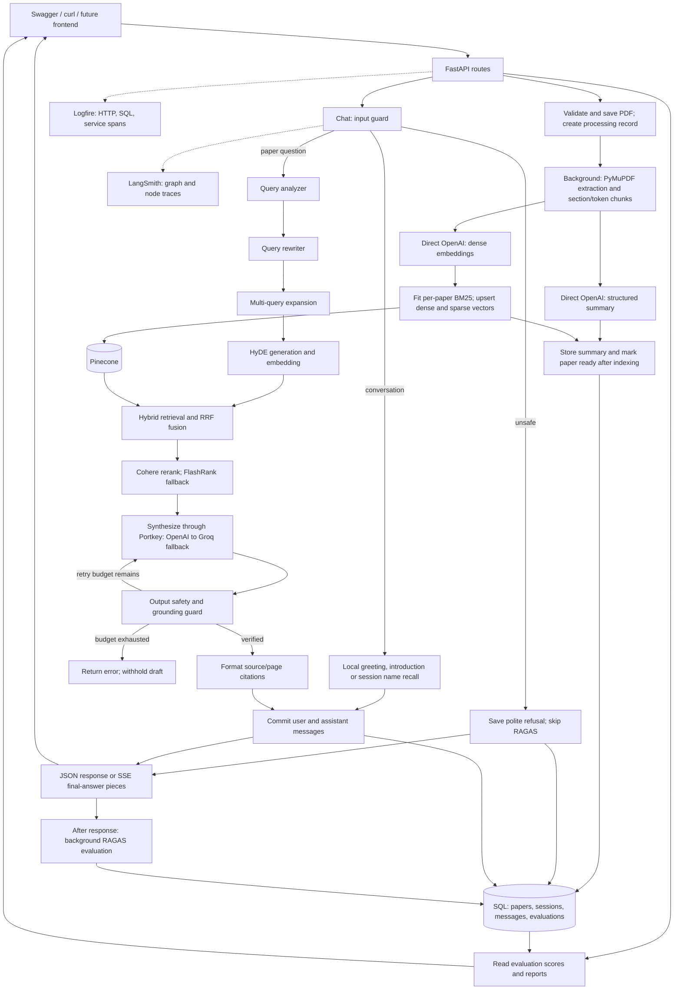

# Research Assistant for PDFs

A FastAPI backend for uploading research papers, generating structured summaries,
and asking paper-scoped questions with page citations. It combines LangGraph,
NeMo Guardrails, Pinecone dense/BM25 hybrid search, reranking, Portkey fallback,
SSE progress, and background RAGAS evaluation.

This repository currently provides the backend API. A frontend is not included;
use Swagger UI or the curl walkthrough below to try it.

## Contents

- [Setup](#setup)
- [Configuration](#configuration)
- [Architecture](#architecture)
- [API reference](#api-reference)
- [Curl walkthrough](#curl-walkthrough)
- [Streaming and evaluation](#streaming-and-evaluation)
- [Checks and troubleshooting](#checks-and-troubleshooting)
- [Project layout](#project-layout)

## Setup

### 1. Get the project and create a Python environment

Use **Python 3.11** for the backend and the LangGraph dev / Studio dependencies.
You need Git, internet access for dependency/model downloads, and credentials
for OpenAI, Pinecone and Portkey. Configure a Groq target in Portkey for fallback.

PowerShell with Conda (skip cloning if you already have the project):

```powershell
git clone https://github.com/Husniahmed10/Research-Assistant-for-PDFs.git
cd Research-Assistant-for-PDFs
conda create -n paperlens python=3.11 -y
conda activate paperlens
cd backend
```

Alternatively, create a virtual environment from the repository root:

```powershell
py -3.11 -m venv .venv
.\.venv\Scripts\Activate.ps1
cd backend
```

On macOS/Linux, the equivalent environment setup is:

```bash
python3.11 -m venv .venv
source .venv/bin/activate
cd backend
```

Run all remaining Python commands **from `backend/`** with the environment active.
The settings loader reads `.env` relative to the working directory; the default
SQLite database, uploads and model cache paths are also relative to it.

### 2. Install dependencies and configure credentials

```powershell
python -m pip install -r requirements.txt
if (-not (Test-Path .env)) { Copy-Item .env.example .env }
```

On macOS/Linux, use `[ -f .env ] || cp .env.example .env` for the copy step.
Edit `backend/.env` using the [configuration guide](#configuration). Replace the
required placeholders and clear unused optional credentials. Keep the pinned
Logfire/OpenTelemetry/setuptools versions in `requirements.txt` together.

For VS Code, run **Python: Select Interpreter** and choose this environment.
Verify that the active interpreter can import the required packages:

```powershell
python -c "import sys, fastapi, pinecone, logfire; print(sys.executable)"
```

### 3. Prepare retrieval resources

```powershell
python -m nltk.downloader punkt punkt_tab stopwords
python -c "from services.reranker import prepare_flashrank; prepare_flashrank()"
```

NLTK resources support BM25 tokenization. The second command downloads/loads the
local FlashRank model. Keep its cache available if you want reranking fallback
without downloading weights at request time.

### 4. Start the API

```powershell
python -m uvicorn main:app --reload --host 127.0.0.1 --port 8000
```

Open:

- Swagger UI: <http://127.0.0.1:8000/docs>
- ReDoc: <http://127.0.0.1:8000/redoc>
- OpenAPI JSON: <http://127.0.0.1:8000/openapi.json>
- Liveness: <http://127.0.0.1:8000/>

There is no separate table-creation command for local setup. Startup configures
LangSmith before graph imports and Logfire before serving, then initializes DB
tables, connects/creates the Pinecone index, loads saved BM25 parameters, and
creates the uploads directory. Initialization failures stop startup. API routers
are registered once during app construction.

## Configuration

Start from [backend/.env.example](backend/.env.example). Never commit `.env`,
provider credentials, uploaded PDFs, local databases or downloaded model weights.

| Setting | Purpose / local default |
|---|---|
| `OPENAI_API_KEY` | Required for direct summary generation, embeddings and RAGAS. A Portkey virtual key does not replace this direct API key. |
| `OPENAI_MODEL` | Summary model and requested primary chat model; default `gpt-4o`. |
| `OPENAI_EMBEDDING_MODEL` | Default `text-embedding-3-small`; embedding dimensions must match the Pinecone index. |
| `PORTKEY_API_KEY` | Required for gateway calls used by the chat agent and semantic guardrails. |
| `PORTKEY_CONFIG_ID` | Saved gateway configuration defining primary OpenAI and secondary Groq targets. Preferred when inline configs are blocked. |
| `PORTKEY_VIRTUAL_KEY_OPENAI`, `PORTKEY_VIRTUAL_KEY_GROQ` | Portkey virtual key IDs used when building an inline fallback config. |
| `GROQ_API_KEY`, `GROQ_MODEL` | Inline fallback credentials/model if virtual keys or Model Catalog names are not used. A saved config manages its own targets. |
| `PINECONE_API_KEY`, `PINECONE_INDEX_NAME` | Required vector service access and the index name; default name `research-assistant`. |
| `PINECONE_ENVIRONMENT`, `PINECONE_DIMENSION` | AWS region (default `us-east-1`) and dense dimension (default `1536`). Index metric must be `dotproduct`. |
| `DATABASE_URL` | Async database URL; default `sqlite+aiosqlite:///./research_assistant.db`. |
| `UPLOAD_DIR`, `MAX_FILE_SIZE_MB` | Upload directory and maximum file size; defaults `uploads`, `50`. |
| `CHUNK_SIZE`, `CHUNK_OVERLAP` | Fallback token windows; defaults `512`, `64`. Semantic sections are used when headings are detected. |
| `TOP_K_RETRIEVAL`, `TOP_K_RERANK`, `HYBRID_ALPHA` | Defaults `20`, `5`, `0.7`. Alpha weights dense vs sparse query vectors. |
| `COHERE_API_KEY`, `COHERE_RERANK_MODEL` | Optional primary reranker; clear the key to use local FlashRank. Default model `rerank-english-v3.0`. |
| `FLASHRANK_MODEL`, `FLASHRANK_CACHE_DIR` | Local reranker and cache; defaults `ms-marco-TinyBERT-L-2-v2`, `.cache/flashrank`. |
| `LOGFIRE_TOKEN` | Optional; leave empty for local-only tracing without cloud export. |
| `LANGCHAIN_API_KEY`, `LANGCHAIN_TRACING_V2` | Optional LangSmith tracing; empty key or `false` disables remote tracing. |
| `LANGCHAIN_PROJECT`, `LANGCHAIN_ENDPOINT` | LangSmith project and endpoint; defaults `research-assistant`, `https://api.smith.langchain.com`. |
| `DEBUG` | Controls SQLAlchemy query echo; use `false` to avoid verbose SQL logs. |

Clear these optional example values if you are not using their services:

```dotenv
COHERE_API_KEY=
LOGFIRE_TOKEN=
LANGCHAIN_API_KEY=
LANGCHAIN_TRACING_V2=false
```

### Portkey fallback setup

In Portkey, configure working OpenAI and Groq provider credentials and create a
saved fallback config. Use actual virtual key IDs and models enabled in your
accounts in place of the placeholders below:

```json
{
  "strategy": { "mode": "fallback" },
  "targets": [
    {
      "virtual_key": "<openai-virtual-key-id>",
      "override_params": { "model": "<openai-model>", "temperature": 0.1 }
    },
    {
      "virtual_key": "<groq-virtual-key-id>",
      "override_params": { "model": "<groq-model>", "temperature": 0.1 }
    }
  ]
}
```

Put the saved config ID in `PORTKEY_CONFIG_ID`. The JSON editor does not substitute
local `.env` variable names: enter the actual IDs/model names. Match the saved
config to the intended primary/fallback models; template model names are not a
guarantee of availability in your provider account.

If no saved config ID is configured, the backend builds an inline fallback config
from Model Catalog model names, virtual keys or direct provider keys. Summary
and embedding calls still go directly to OpenAI; Portkey fallback applies to the
agent's gateway calls, not to every external service.

### Pinecone and persistent files

The API creates a missing AWS serverless index using the configured region,
dimension and `dotproduct` metric. An existing index with incompatible dimensions
or metric stops startup. Keep the SQLite database and `uploads/` persistent
between runs. BM25 parameters are stored per paper under
`uploads/bm25/<paper-id-hash>/bm25_params.json`; deleting a paper removes its
vectors and encoder parameters as well as its file and SQL records.

## Architecture



The graph loads the last four messages from SQL for conversational context. It
currently uses **SQL history, not a LangGraph checkpointer**. Exact name-recall
questions (such as "what is my name?") additionally look up simple user
introductions across the full saved session, including older messages. This
lookup is scoped to the session and excludes assistant-authored text. The reply
has no paper citations, makes no model/retrieval calls, and skips RAGAS. If no
name is found, the assistant says so. Greeting prefixes such as "hey" are
accepted. Brief greetings, thanks, acknowledgements and standalone introductions
receive local replies as well. Introductions attached to paper questions still
follow the retrieval path. Public author email/affiliation requests and contextual
follow-ups pass to retrieval; missing details must be reported honestly rather
than guessed. This is limited display-name recall;
other paper questions still use the recent four-message context. HyDE text is a
retrieval aid and is never used as evidence. Output checks permit a bounded retry
(default two generation attempts); failed verification never releases the draft.

## API reference

Base URL: `http://127.0.0.1:8000`. Paper, session and message path IDs are UUIDs.
The current routes have no authentication/authorization layer. CORS permits
`http://localhost:3000`; change `backend/main.py` for a different frontend origin.

| Method | Path | Request | Result |
|---|---|---|---|
| GET | `/` | None | `200`: lightweight liveness `{status, app}`. |
| GET | `/api/v1/health/` | None | `200` healthy or `503` degraded; DB, Pinecone and gateway checks plus UTC timestamp. Alias: `/api/v1/health`. |
| POST | `/api/v1/papers/upload` | Multipart field `file` containing a PDF | `202`: `{paper_id, filename, status: "processing"}`; schedules background processing. |
| GET | `/api/v1/papers/` | None | `200`: uploaded papers with IDs, size, page count, status and creation time. |
| GET | `/api/v1/papers/{paper_id}/status` | None | `200`: `{paper_id, status, page_count}`. |
| GET | `/api/v1/papers/{paper_id}/summary` | None | `200`: the six-section summary; `409` while unavailable/processing or failed. |
| DELETE | `/api/v1/papers/{paper_id}` | None | `200`: `{message: "deleted"}`; processing papers return `409`. |
| POST | `/api/v1/chat/sessions` | JSON `{ "paper_id": "UUID" }` | `201`: `{session_id, paper_id, created_at}`; paper must be ready. |
| POST | `/api/v1/chat/sessions/{session_id}/message` | JSON `{ "query": "Question" }` | `200`: `{answer, citations, model_used, latency_ms, steps, message_id}`; schedules eligible RAGAS evaluation. |
| GET | `/api/v1/chat/sessions/{session_id}/stream` | URL query parameter `query` | `200`: SSE `step`, `token`, `done` or `error` events. Creates a new chat exchange. |
| GET | `/api/v1/chat/sessions/{session_id}/messages` | None | `200`: chronological saved messages with IDs, citations, model and latency. |
| GET | `/api/v1/evaluation/messages/{message_id}` | None | `200`: scores/status, or `202` pending; user messages return `400`, unscheduled/missing evaluations `404`. |
| GET | `/api/v1/evaluation/sessions/{session_id}/summary` | None | `200`: completed-answer averages, status counts and score history. |
| GET | `/api/v1/evaluation/papers/{paper_id}/report` | None | `200`: quality report across all sessions, question count, average latency and saved-answer model usage. |
| GET | `/docs` | None | Interactive Swagger UI. |
| GET | `/redoc` | None | ReDoc API reference. |
| GET | `/openapi.json` | None | Machine-readable API schema. |

Summary keys: `title_and_authors`, `abstract`, `problem_statement`, `methodology`,
`key_results`, `conclusion`.

Common errors: `400` invalid PDF, `404` missing resource, `422` malformed/invalid
request, `409` processing conflict, `500` unexpected internal error, `502` failed
answer verification, and `503` unavailable dependency/provider. Errors use
`{"detail": ...}`. Unknown internal errors are sanitized and logged to Logfire.
Input policy rejections return a polite chat refusal with empty citations and
`model_used="none"`. SSE failures after headers are sent use an `error` event.

## Curl walkthrough

### PowerShell: upload, wait, chat, evaluate

Use **`curl.exe`**, since Windows PowerShell can alias `curl` to another command.
Run these commands in a second terminal while the API is running. Replace the
PDF path. Responses are parsed into variables so you do not have to copy UUIDs.
JSON is written to temporary files to avoid native-command quoting differences
between PowerShell versions.

```powershell
$base = "http://127.0.0.1:8000/api/v1"
$pdf = "C:\path\to\paper.pdf"

# Lightweight liveness, then full dependency health (includes a real gateway call).
curl.exe -sS "http://127.0.0.1:8000/"
curl.exe -i "$base/health/"

# Upload the paper.
$upload = curl.exe -sS -X POST "$base/papers/upload" --form "file=@$pdf;type=application/pdf" | ConvertFrom-Json
$paperId = $upload.paper_id
if (-not $paperId) { throw "Upload failed; inspect the API response." }

# Poll at most 90 times, two seconds apart, for extraction, summary and indexing.
for ($attempt = 0; $attempt -lt 90; $attempt++) {
    $status = curl.exe -sS "$base/papers/$paperId/status" | ConvertFrom-Json
    if ($status.status -eq "ready") { break }
    if ($status.status -eq "failed") { throw "Paper processing failed; inspect backend logs." }
    Start-Sleep -Seconds 2
}
if ($status.status -ne "ready") { throw "Still processing or unavailable; check the status endpoint and logs." }

# Read the summary and list papers.
curl.exe -sS "$base/papers/$paperId/summary"
curl.exe -sS "$base/papers/"

# Create a paper-scoped session.
$sessionBody = Join-Path $env:TEMP "paperlens-session.json"
[System.IO.File]::WriteAllText($sessionBody, (@{ paper_id = $paperId } | ConvertTo-Json -Compress))
$session = curl.exe -sS -X POST "$base/chat/sessions" -H "Content-Type: application/json" --data-binary "@$sessionBody" | ConvertFrom-Json
$sessionId = $session.session_id
if (-not $sessionId) { throw "Session creation failed; inspect the API response." }

# Ask a question and retain the assistant message ID for evaluation.
$messageBody = Join-Path $env:TEMP "paperlens-message.json"
[System.IO.File]::WriteAllText($messageBody, (@{ query = "What are the main findings and limitations?" } | ConvertTo-Json -Compress))
$reply = curl.exe -sS -X POST "$base/chat/sessions/$sessionId/message" -H "Content-Type: application/json" --data-binary "@$messageBody" | ConvertFrom-Json
$reply | ConvertTo-Json -Depth 10
$messageId = $reply.message_id
if (-not $messageId) { throw "Chat failed; inspect the API response." }

# History and evaluation reports. Repeat the score GET if it returns HTTP 202.
curl.exe -sS "$base/chat/sessions/$sessionId/messages"
curl.exe -i "$base/evaluation/messages/$messageId"
curl.exe -sS "$base/evaluation/sessions/$sessionId/summary"
curl.exe -sS "$base/evaluation/papers/$paperId/report"
```

To ask another question using SSE instead of POST:

```powershell
curl.exe -N --get --data-urlencode "query=How does the proposed method work?" "$base/chat/sessions/$sessionId/stream"
```

Optional cleanup, after viewing the reports (also deletes sessions/messages/scores):

```powershell
curl.exe -sS -X DELETE "$base/papers/$paperId"
```

### Bash: equivalent request examples

Replace the IDs with values returned by upload, session creation and chat. Wait
for the uploaded paper's status to become `ready` before creating a session.

```bash
BASE=http://127.0.0.1:8000/api/v1
curl -sS -X POST "$BASE/papers/upload" -F 'file=@/path/to/paper.pdf;type=application/pdf'
PAPER_ID='replace-with-upload-paper-id'
curl -sS "$BASE/papers/$PAPER_ID/status"
curl -sS "$BASE/papers/$PAPER_ID/summary"
curl -sS -X POST "$BASE/chat/sessions" -H 'Content-Type: application/json' \
  -d "{\"paper_id\":\"$PAPER_ID\"}"
SESSION_ID='replace-with-session-id'
curl -sS -X POST "$BASE/chat/sessions/$SESSION_ID/message" -H 'Content-Type: application/json' \
  -d '{"query":"What are the main results?"}'
MESSAGE_ID='replace-with-assistant-message-id'
curl -i "$BASE/evaluation/messages/$MESSAGE_ID"
curl -sS "$BASE/evaluation/sessions/$SESSION_ID/summary"
curl -sS "$BASE/evaluation/papers/$PAPER_ID/report"
curl -N --get --data-urlencode 'query=What are the limitations?' "$BASE/chat/sessions/$SESSION_ID/stream"
```

## Streaming and evaluation

SSE progress arrives while the graph runs. Answer `token` events contain
whitespace-preserving pieces of the **validated, saved final answer**, not raw
provider tokens. Drafts that fail output checks are withheld. A typical stream is:

```text
data: {"type":"step","content":"Running hybrid search..."}

data: {"type":"step","content":"Reranking results..."}

data: {"type":"token","content":"The"}

data: {"type":"token","content":" model"}

data: {"type":"done","citations":[],"model_used":"actual-response-model","message_id":"assistant-message-uuid","latency_ms":1200}

```

Close browser `EventSource` connections on `done` or `error` and handle transport
errors explicitly: automatic reconnects to this GET route can submit the question
again. `done.message_id` can be used to poll the evaluation endpoint. Keep-alive
comments are sent during long graph operations. Disconnecting before persistence
cancels graph work; messages already committed remain in history.

Eligible answers are evaluated after response delivery using direct OpenAI
`gpt-4o-mini` and `text-embedding-3-small`. No golden dataset is required for
faithfulness, answer relevancy and reference-free context utilization. The API
exposes the last metric as `context_precision` and identifies its actual variant
with `precision_metric="context_utilization"`. Calling the evaluation service
with a reference `ground_truth` enables reference-based context precision and
context recall; the live chat routes do not accept reference answers.

The overall score weights faithfulness **40%**, answer relevancy **35%**, and
precision **25%**. Labels are Excellent (>=0.8), Good (>=0.6), Fair (>=0.4), and
Poor (<0.4). Missing/non-finite scores remain null, with no overall label. Score
states are `pending`, `completed`, `failed` or `skipped`; legacy messages may have
no scheduled evaluation and return 404. Reports average completed evaluations;
`model_usage` counts saved answer models, not provider attempts/fallback calls.

## Checks and troubleshooting

Run focused provider-mocked API checks from `backend/`:

```powershell
python -m unittest utils.test_papers utils.test_chat utils.test_chat_stream utils.test_conversation_memory utils.test_evaluation utils.test_health_errors utils.test_tracing -q
```

For retrieval/agent utilities, run:

```powershell
python -m unittest utils.test_processing utils.test_pinecone utils.test_hybrid utils.test_reranking utils.test_agent_nodes utils.test_agent_graph utils.test_guardrails utils.test_summary_app utils.test_rag_gateway -q
```

These checks use temporary resources and mocked cloud calls. NLTK resources must
be available for BM25 checks. Live smoke checks below make real provider calls:

```powershell
python -m utils.test_rag_gateway --live
python -m utils.check_input_guard --live
# Or target a specific normal-query regression:
python -m utils.check_input_guard --live --case email_followup
```

| Symptom | What to check |
|---|---|
| Pylance cannot resolve `fastapi`, `pinecone` or `logfire` | Select the environment used for `python -m pip install`; verify imports and reload the VS Code window. |
| Configuration/import failures when starting from the repo root | Change directory to `backend` before running Uvicorn or test modules. |
| Startup fails on Pinecone | Check credentials, region, permissions, index name, dense dimension and `dotproduct` metric. |
| Inline Portkey config is rejected | Create a saved config, set `PORTKEY_CONFIG_ID`, and confirm both provider targets work in that config. |
| Missing NLTK tokenization data | Run the NLTK downloader command in setup using the active interpreter. |
| FlashRank cannot download weights | Prepare the model while online and keep `FLASHRANK_CACHE_DIR` available. |
| Paper stays `processing` after a server restart | Background tasks are in-process; an interrupted job is not automatically resumed. Inspect logs/status before retrying. |
| Evaluation returns `failed` or null scores | Check the direct OpenAI key, model access and logs. Chat remains saved even if evaluation fails. |
| LangSmith `/runs/batch` returns 403 | Trace uploads were forbidden. Check LangSmith credentials/project access, or set `LANGCHAIN_TRACING_V2=false` while debugging. These uploads are separate from input-policy decisions. |
| Health reports `degraded` | Inspect its component statuses. It performs real dependency calls; `/` is the cheap liveness check. |

Current limits: text PDFs only (no OCR for scanned pages); no authentication or
user isolation; no durable background task queue; no LangGraph checkpoint store.
Upload processing and RAGAS jobs can be interrupted by restart/reload. Summary
input is truncated to 12,000 tokens, so later sections of long papers may not be
represented in the summary. Questions are limited to 2,000 tokens and 8,000
characters. Logfire automatic HTTP/SQL traces and LangSmith states may contain
request/document data; configure optional remote tracing according to your needs.

## Project layout

```text
backend/
  main.py                  FastAPI wiring, lifecycle, CORS and exception handlers
  .env.example             Configuration template
  requirements.txt         Pinned dependencies
  api/routes/
    papers.py              Upload, processing status, summary and deletion
    chat.py                JSON/SSE chat and persisted history
    evaluation.py          Message/session/paper quality reports
    health.py              Dependency readiness checks
  agents/
    state.py               AgentState and incremental progress reducer
    graph.py               Ten-node graph with safety and retry routing
    nodes/                 Guard, planning, retrieval, reranking and answer nodes
  core/                    Settings, dependency injection and error boundaries
  db/                      Async engine, CRUD and four SQL tables
  services/                PDF, embeddings, search, gateway, reranking and RAGAS
  guardrails/              NeMo YAML, Colang and explicit validation actions
  tracing/                 Logfire and LangSmith setup
  utils/                   File/text helpers and executable checks
  uploads/                 Ignored PDF files and fitted BM25 parameters
```

See [backend implementation notes](backend/README.md) for detailed retrieval,
guardrail, evaluation, tracing and browser SSE behavior. The
[master plan](Research_Assistant_Master_Plan.md) and
[four-day backend plan](4_Day_Backend_Implementation_Plan.md) describe the project
plan; the running API and this README describe implemented behavior.
